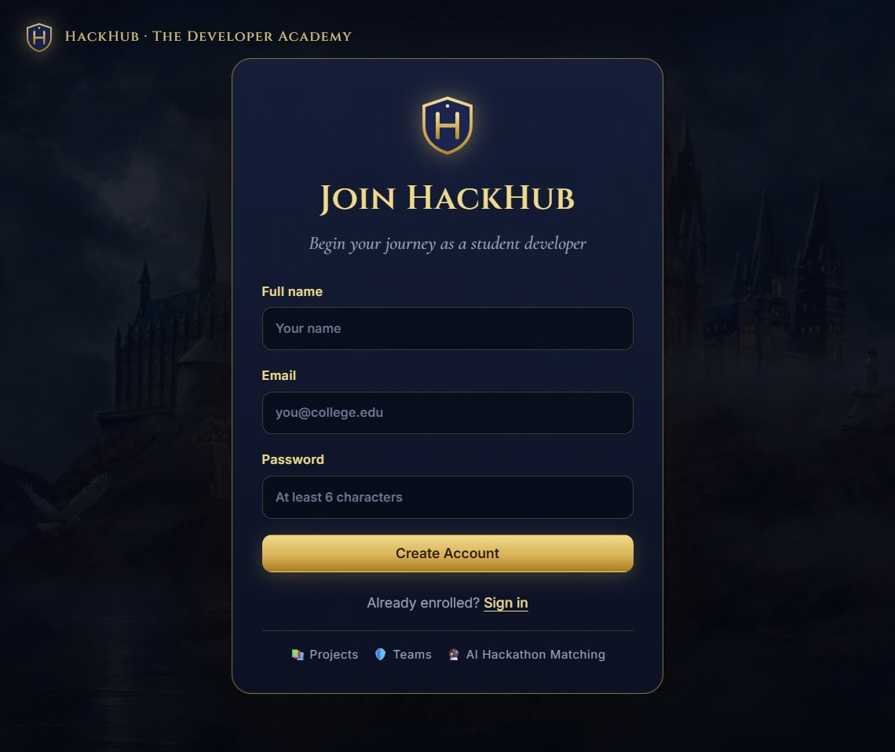
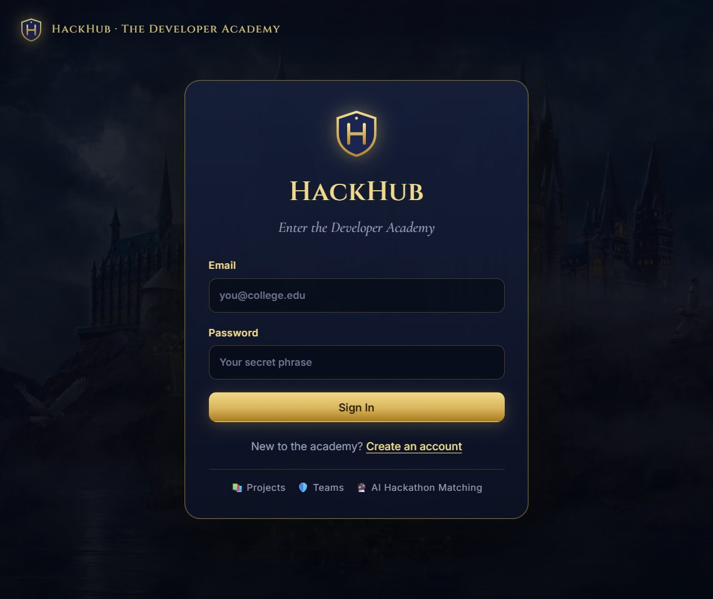

# HackHub

HackHub is a full-stack web app for student developers. You can post your projects, create or join teams, browse a list of open hackathons, and type in the technologies you know to get hackathons ranked by how well they match.

It is a learning project covering the MERN stack (React, Express, MongoDB, JWT auth), with a small semantic-search feature on top that uses sentence embeddings and MongoDB Atlas Vector Search. The code was written with AI assistance.

The interface uses a "magical academy" theme, so some labels are playful. For example, the dashboard is called the Great Hall and teams are called fellowships.

## Why this exists

Hackathon listings, project ideas and teammates usually live in different places. HackHub puts a basic version of all three in one app: a project library, a team list, and a hackathon list with skill-based recommendations.

## Live demo

- Frontend: https://frontend-three-orpin-83.vercel.app
- API: https://hackhub-api-86m6.onrender.com/api/health

The API runs on Render's free plan and sleeps after 15 minutes without traffic, so the first request after a pause can take about 30 seconds.

## Features

What is implemented in the code:

- **Accounts:** register and log in. Passwords are hashed with bcrypt and sessions use JWTs that expire after one day.
- **Projects:** create, view, edit and delete projects (name, description, category, tech stack, status). Only the owner can edit or delete a project. The library page has search, category and status filters, and sorting. There is also a "My Projects" page.
- **Teams:** create a team, join it, leave it, and see its members. The team owner cannot leave.
- **Hackathons:** a list of hackathons with organizer, deadline, mode, tech tags and a link to the official Unstop page. You can search it and filter by technology.
- **Recommendations:** enter skills like `React, Node.js, MongoDB` and get the five closest hackathons with a match score.
- **Landing page and dashboard:** a public landing page that previews hackathons, and a dashboard that shows counts for your projects, all projects, teams and hackathons.
- **Responsive layout:** sidebar on desktop, slide-out menu on mobile.

## How the recommendation works

1. Each hackathon's name, description, tech stack and skills are turned into a 384-dimension vector with the `Xenova/all-MiniLM-L6-v2` model (run locally through `@xenova/transformers`). This is done once by `npm run seed:embeddings` and stored in the `embedding` field.
2. When a user submits skills, the same model embeds that text.
3. The backend asks MongoDB Atlas Vector Search (`$vectorSearch`, cosine similarity, index `hackathon_vector_index`) for the closest hackathons.
4. If the Atlas index is missing, still building, or you are on a plain local MongoDB, the backend falls back to computing cosine similarity in Node over the stored embeddings. The response says which method was used in its `method` field.

The vector math for the fallback is in `utils/vector.js` and has unit tests.

## Tech stack

| Part | Technology | Why |
|---|---|---|
| Frontend | React 19, Vite, Axios | React for the UI, Vite for fast dev and build, Axios for API calls with an interceptor that attaches the JWT |
| Styling | Plain CSS | One stylesheet, no UI library |
| Backend | Node.js, Express 5 | REST API with routes, controllers and middleware |
| Database | MongoDB, Mongoose | Document storage and schemas with validation |
| Auth | jsonwebtoken, bcrypt | Stateless login and password hashing |
| Search | @xenova/transformers, Atlas Vector Search | Embeddings without a paid API, and vector search on the same database |
| Tooling | Docker, GitHub Actions, ESLint | Container image, CI checks, frontend linting |

## Project structure

```
.
├── server.js                  Express app setup, CORS, health route, error handling
├── config/db.js               MongoDB connection
├── routes/                    auth, projects, teams, hackathons
├── controllers/               request handling for each route group
├── middleware/authMiddleware.js   JWT check
├── models/                    User, Project, Team, Hackathon (Mongoose)
├── services/embeddingService.js   loads the embedding model, creates vectors
├── utils/                     helpers.js, vector.js (cosine similarity)
├── seed/                      hackathon data, embedding script, Atlas index script
├── tests/                     vector.test.js (unit), smoke.test.js (API)
├── scripts/check-syntax.js    syntax check for backend files
├── frontend/                  React + Vite app with its own package.json
├── Dockerfile, docker-compose.yml, render.yaml
└── .github/workflows/ci.yml
```

## Running it locally

You need Node.js 18 or newer (the Docker image and CI use 22) and a MongoDB database. A free MongoDB Atlas cluster works best because it is the only way to use Atlas Vector Search. A local MongoDB also works, with the in-Node fallback described above.

### Backend

```bash
git clone https://github.com/ridhima936/HACKHUB-.git
cd HACKHUB-
npm install
cp .env.example .env
```

Open `.env` and fill in `MONGO_URI` and `JWT_SECRET` (see the table below). You can generate a secret with:

```bash
node -e "console.log(require('crypto').randomBytes(48).toString('hex'))"
```

Load the hackathons and build their embeddings:

```bash
npm run seed
```

The first run downloads the embedding model (about 90 MB). Note that `npm run seed` deletes all existing hackathon records before inserting the list in `seed/hackathons.js`.

If you are using Atlas, create the vector index once:

```bash
npm run create-index
```

It takes about a minute to become ready. Until then the API uses the fallback search.

Start the API:

```bash
npm start
```

It runs on http://localhost:5000. Check http://localhost:5000/api/health to confirm it is connected.

### Frontend

In a second terminal:

```bash
cd frontend
npm install
cp .env.example .env     # optional, the default API URL is already localhost:5000
npm run dev
```

The app runs on http://localhost:5173.

From the repo root, `npm run install:all` installs both sets of dependencies and `npm run client` starts the frontend.

### Docker (backend only)

```bash
cp .env.example .env     # set JWT_SECRET
docker compose up --build
```

This starts the API and a local MongoDB. `docker-compose.yml` overrides `MONGO_URI` to point at that container. Atlas Vector Search is not available there, so recommendations use the fallback. Run `docker compose exec api npm run seed` once to load the data.

## Environment variables

Never commit a real `.env` file. It is already in `.gitignore`.

**Backend (`.env` in the repo root)**

| Variable | Required | Description |
|---|---|---|
| `MONGO_URI` | Yes | MongoDB connection string, including the database name |
| `JWT_SECRET` | Yes | Long random string used to sign tokens. The server exits if it is missing |
| `PORT` | No | API port, default `5000` |
| `CLIENT_URL` | No | Comma-separated list of allowed frontend origins for CORS, default `http://localhost:5173`. Any `localhost` origin is also allowed |
| `PRELOAD_MODEL` | No | Set to `false` to skip loading the embedding model at startup |
| `FORCE` | No | Set to `1` when running `npm run seed:embeddings` to regenerate existing embeddings |

**Frontend (`frontend/.env`)**

| Variable | Required | Description |
|---|---|---|
| `VITE_API_URL` | No | API base URL, default `http://localhost:5000/api`. It is baked in at build time, and anything in a `VITE_*` variable ends up in the public bundle, so never put secrets there |

## API endpoints

All routes are under `/api`. "Auth" means an `Authorization: Bearer <token>` header is required.

| Method | Route | Auth | Description |
|---|---|---|---|
| GET | `/health` | No | Server and database status |
| POST | `/auth/register` | No | Create an account (`name`, `email`, `password`) |
| POST | `/auth/login` | No | Log in, returns a token and basic user info |
| GET | `/auth/me` | Yes | Current user |
| GET | `/projects` | No | List projects, optional `search` and `category` query params |
| GET | `/projects/my` | Yes | Projects owned by the current user |
| GET | `/projects/:id` | No | One project |
| POST | `/projects` | Yes | Create a project |
| PATCH | `/projects/:id` | Yes, owner | Update a project |
| DELETE | `/projects/:id` | Yes, owner | Delete a project |
| GET | `/teams` | No | List teams with owner and members |
| POST | `/teams` | Yes | Create a team |
| POST | `/teams/:id/join` | Yes | Join a team |
| POST | `/teams/:id/leave` | Yes | Leave a team (not allowed for the owner) |
| GET | `/hackathons` | No | List hackathons, optional `search` and `techStack` query params |
| GET | `/hackathons/:id` | No | One hackathon |
| POST | `/hackathons/recommend` | No | Body `{ "techStack": ["React", "Node.js"] }`, returns up to 5 ranked hackathons |

Example:

```bash
curl -X POST http://localhost:5000/api/hackathons/recommend \
  -H "Content-Type: application/json" \
  -d '{"techStack":["React","Node.js","MongoDB"]}'
```

The response contains `method` (`atlas-vector-search` or `local-cosine`), `model`, `total` and a `recommendations` array where each item has a `score` between 0 and 1. If no embeddings exist yet it returns 503 with a message telling you to run the seed.

## Screenshots

Only the sign-in and register screens are captured so far.

| Register | Sign in |
|---|---|
|  |  |

Still to add:

- Dashboard: `docs/screenshot-dashboard.png`
- Project library: `docs/screenshot-projects.png`
- Teams: `docs/screenshot-teams.png`
- Hackathons and recommendations: `docs/screenshot-hackathons.png`

## Testing

| Command | What it runs | Needs |
|---|---|---|
| `npm test` | 10 unit tests for the vector math | Nothing |
| `npm run test:api` | 39 API checks covering auth, projects, teams, hackathons and recommendations | Running server and seeded database |
| `npm run check` | Syntax check of backend files | Nothing |
| `npm run lint:client` | ESLint on the frontend | Frontend dependencies |
| `npm run build:client` | Production build of the frontend | Frontend dependencies |

GitHub Actions runs the syntax check, unit tests, frontend lint and frontend build on every push and pull request. The API tests are not part of CI because they need a live database.

## Deployment

- **Backend:** Render, using the `Dockerfile` through `render.yaml` (free plan, health check at `/api/health`). `MONGO_URI` and `CLIENT_URL` are entered in the Render dashboard, and `JWT_SECRET` is generated by Render. After the first deploy, run `npm run seed` and `npm run create-index` once from the Render shell.
- **Frontend:** Vercel with `frontend` as the root directory and `VITE_API_URL` set to the Render API URL ending in `/api`. `frontend/vercel.json` handles the build and the single-page-app rewrite.
- **Database:** MongoDB Atlas.

If you deploy the frontend first, add its URL to `CLIENT_URL` on the backend afterwards, otherwise CORS will block it.

## Known limitations

- Hackathon data is entered by hand in `seed/hackathons.js` (with `source` and `lastChecked` fields), not fetched live. Deadlines go out of date, so the list needs to be refreshed and re-seeded.
- `GET /api/teams` is public and includes member names and emails. This should be restricted.
- There is no rate limiting. `POST /hackathons/recommend` is public and runs the embedding model, so it could be abused.
- The JWT is kept in `localStorage`, which is simple but exposed to XSS.
- Projects are filtered and sorted in the browser after loading all of them, so there is no pagination.
- A project cannot yet be linked to a team.
- The `rating` field exists in the Project model but is not used anywhere in the API or the UI.

## Future improvements

- Restrict what `GET /teams` returns, and add rate limiting
- Link projects to teams
- Pagination and server-side filtering for projects
- Bookmark hackathons and get deadline reminders
- A profile page with skills and GitHub links
- A simple way to refresh the hackathon list without editing the seed file
- More tests, including API tests that can run in CI against a test database

## Contributing

See [CONTRIBUTING.md](CONTRIBUTING.md). Small, focused pull requests are easiest to review.

## Author

Ridhima Chopra, Computer Engineering student at Thapar Institute of Engineering and Technology, Patiala.

- GitHub: [ridhima936](https://github.com/ridhima936)
- LinkedIn: [ridhima-chopra](https://www.linkedin.com/in/ridhima-chopra-a33053369)

## License

MIT, see [LICENSE](LICENSE).
